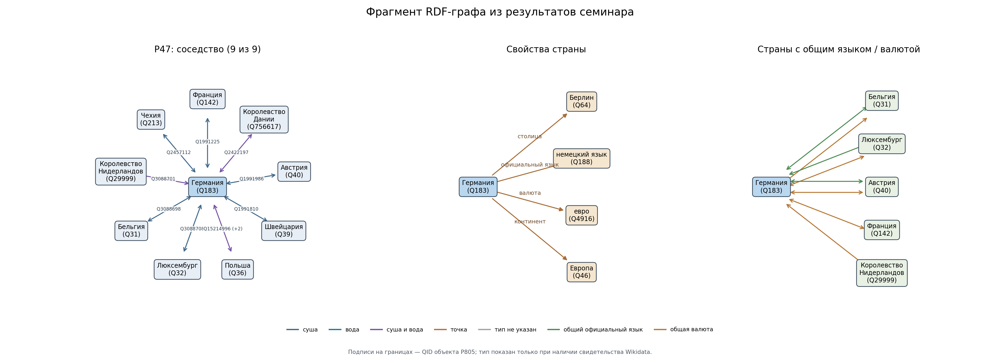

# Краткий отчёт — семинар 5, вариант 57

## Данные и RDF-граф

28 октября 2026 года ноутбук получил данные напрямую из Wikidata Query Service. Запросы, ответы и результаты сохранены в `results/`. Выборка содержит 196 государств со связями P47 и 433 неупорядоченные пары соседства. Для обучения использованы **1875 ресурсных троек** пяти отношений: P47 (граничит), P36 (столица), P37 (официальный язык), P38 (валюта), P30 (континент). P47, P37 и P38 дают связи N:N. В полном RDF-графе 10 943 тройки: помимо прямых отношений есть подтверждённые типы границ, пограничные объекты, производные связи между странами, служебные описания и 196 числовых литералов `ex:neighborCountInExtract` типа `xsd:integer`. Поэтому общее число RDF-троек нельзя выдавать за число независимых прямых фактов Wikidata. Turtle и два исполняемых SPARQL-запроса приведены в ноутбуке.

P47 допускает соседство по суше, воде и в общей точке. Тип конкретной пары добавляется только по квалификатору утверждения P47 или классу указанного в P805 объекта границы. Из 433 пар **199** имеют подтверждение суши, **84** воды, **121** и суши и воды, а для **29** тип не удалось установить. Подтверждённой пары с границей только в точке в этой выгрузке нет; предикат `ex:bordersAtPoint` предусмотрен, но пустой. Для **406** пар найден объект границы P805, для **21** — связанный с ним физический объект P706/P206. Например, [Франция](https://www.wikidata.org/wiki/Q142) и [Германия](https://www.wikidata.org/wiki/Q183) имеют сухопутную границу [Q1991225](https://www.wikidata.org/wiki/Q1991225); с её объектом связан [Рейн](https://www.wikidata.org/wiki/Q584). Такая связь с Рейном не означает, что вся граница проходит по реке.

Из общих значений P37 и P38 выведены `ex:sharesOfficialLanguageWith` и `ex:sharesCurrencyWith`. Например, Германия и [Австрия](https://www.wikidata.org/wiki/Q40) связаны через [немецкий язык](https://www.wikidata.org/wiki/Q188) и [евро](https://www.wikidata.org/wiki/Q4916). Производные отношения оставлены в RDF для анализа и рисунка; в KGE их не добавляли, чтобы не раскрывать отложенные прямые P37/P38 при оценке.

### Отрисовка фрагмента графа

[draw_geography_graph.py](draw_geography_graph.py) читает `results/geography57.ttl` и сохраняет `results/graph_example.png`. Слева цвет ребра различает сушу, воду, их сочетание, точку и неизвестный тип; подпись на ребре — QID пограничного объекта P805, если он указан. Если объектов несколько, показаны первый QID и их число; полный список есть в `results/border_details.tsv`. В середине показаны P36, P37, P38, P30. Справа показаны связи стран по общему официальному языку и валюте. Все рёбра берутся из сохранённого RDF-графа. После выполнения ноутбука рисунок можно обновить командой `python draw_geography_graph.py`; `python run_seminar.py` создаёт его автоматически. Параметры `--center` и `--max-neighbors` меняют центральную страну и число показанных соседей.

## Представления и оценка

Случайные прогулки и SVD строят структурные векторы только из train; это учебный аналог DeepWalk/node2vec при p=q=1. TransE и DistMult обучены на NumPy с Adam. На обученных векторах расстояние L1 для известной тройки Германия — P47 — Франция равно **3,1403**, для отрицательной Германия — P47 — Австралия **4,6626**. При margin=1 loss = max(0, 1 + 3,1403 − 4,6626) = **0**. Это проверка одной пары примеров, а не оценка качества всей модели.

Разбиение без пересечений: **1541 train**, **167 validation**, **167 test** троек. Все пять отношений есть в каждой части, все проверяемые сущности встречаются в train; обе стороны одной пары P47 всегда попадают в одну часть. В validation и test для P36 лишь по одному факту, поэтому отдельная оценка этого отношения ненадёжна. Метрики ниже посчитаны по целевому P47, с filtered ranking.

| Выборка | Модель | MRR | Hits@1 | Hits@3 | Hits@10 |
|---|---|---:|---:|---:|---:|
| Validation, P47 | TransE | 0,236 | 0,128 | 0,244 | 0,512 |
| Validation, P47 | DistMult | 0,142 | 0,047 | 0,151 | 0,267 |
| Test, P47 | TransE | 0,204 | 0,081 | 0,233 | 0,419 |
| Test, P47 | DistMult | 0,208 | 0,105 | 0,233 | 0,384 |

TransE выбрана по validation. На test у DistMult немного выше MRR, у TransE выше Hits@10. Статистическая значимость разницы не проверялась. По всем пяти отношениям test MRR равен 0,326 для TransE и 0,301 для DistMult, но агрегат зависит от очень малого числа P36.

## Три ошибки по первичным данным

В `results/errors.csv` записаны разные пары, ранги и ссылки на элементы Wikidata. Истинная P47 есть в сохранённом ответе SPARQL; предсказанной связи в этой выгрузке нет. Отсутствие записи само по себе не доказывает, что предполагаемая географическая граница невозможна.

1. [Великобритания](https://www.wikidata.org/wiki/Q145) — [Мальдивы](https://www.wikidata.org/wiki/Q826): ранг **169**, выше модель поставила [Францию](https://www.wikidata.org/wiki/Q142). У Великобритании в train 7 соседей P47. У исходной пары тип границы не указан, поэтому различить сушу и воду по обучаемому P47 нельзя.
2. [Франция](https://www.wikidata.org/wiki/Q142) — [Суринам](https://www.wikidata.org/wiki/Q730): ранг **139**, модель поставила [Мальту](https://www.wikidata.org/wiki/Q233). У Франции 13 соседей в train; даже такая степень не устраняет ошибки ранжирования, когда P47 объединяет разные типы границ.
3. [Сомали](https://www.wikidata.org/wiki/Q1045) — [Кения](https://www.wikidata.org/wiki/Q114): ранг **73**, модель поставила [Эритрею](https://www.wikidata.org/wiki/Q986). У Сомали в train только 2 соседа P47, что ограничивает структурный сигнал для прогноза.

Числа относятся к сохранённой выгрузке Wikidata; новый запуск может дать другие результаты.
